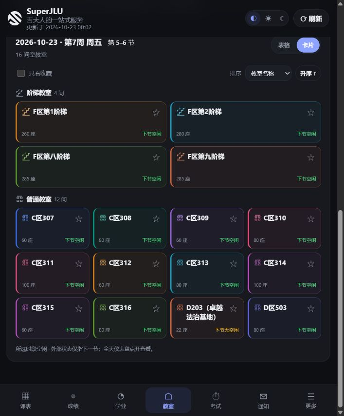
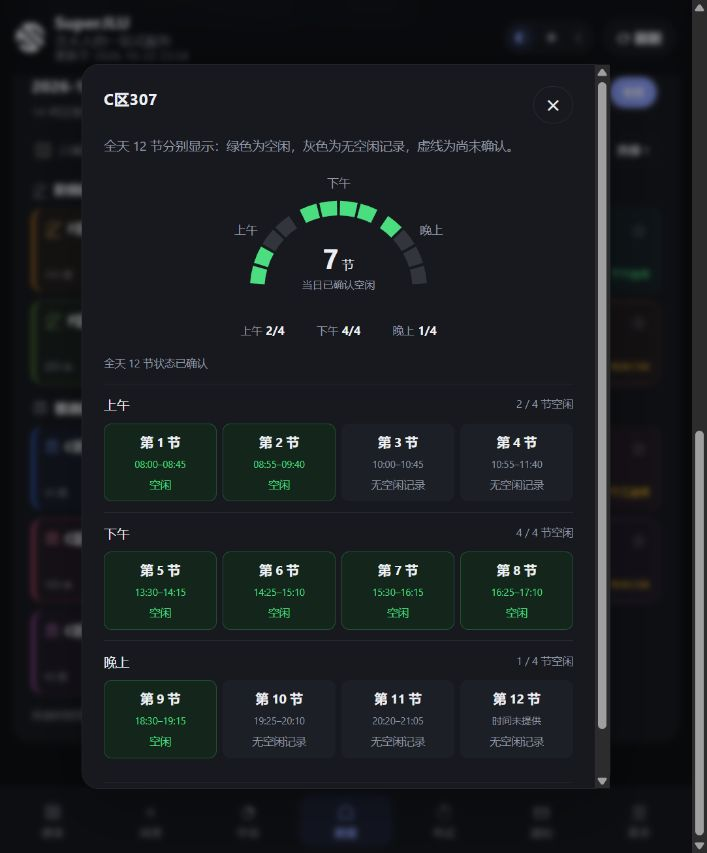

# 空教室卡片与全天预加载

桌面浏览器与 Android WebView 共用 `jlu_toolkit/ui_page.py`，后端使用现有教务会话和查询配置。本文描述最终交互、数据边界及维护者复测步骤。

## 查询的触发时机

1. 进入教室页、选择校区/教学楼、修改日期/节次时，只准备表单和必要的查询元数据，不发起空教室或全天空闲查询。
2. 用户点击「查询空教室」后，先查询并显示所选时段的空教室，再按这次提交的日期、校区、教学楼及其它条件，后台补齐第 1–12 节。
3. 结果展示后自动滚动到结果区；查询失败时保留上次结果并定位到简短错误提示。
4. 全天加载不要求打开详情。关闭详情后，已提交查询的后台任务可以继续；修改查询范围则停止调度旧范围的后续批次，已经发出的请求允许完成。
5. 同范围切换节次后仍需用户点击查询。所需各小节均有有效完整记录时，直接取各节空教室集合的交集；记录缺失或过期则重新查询。缓存不会替用户提交表单。

## 卡片与详情

- 保留表格，并提供分段按钮切换卡片/表格、排序和本机收藏筛选。
- 阶梯教室单独分组、优先展示并占两列；普通教室与阶梯教室使用不同图标。十色布局按当前列数分配，避免同组横向、纵向相邻卡片使用相同颜色。
- 主标题简化重复的校区/教学楼前缀，保留教室编号与特殊教室名称。详情仍显示完整原始名称和位置；跨楼结果保留位置提示。
- 外部卡片仅展示座位数及下一节是否查到空闲记录。`下节无空闲` 不等同于已经确认有课，未取得记录则为 `后续待查`。
- 点击卡片后，详情显示半圆仪表盘和全部 12 个小节：上午 1–4、下午 5–8、晚上 9–12。各时段都保留单节状态，不能用两节合并查询代替单节结果。
- 绿色表示已确认空闲，灰色表示完整查询中无该教室空闲记录，虚线表示未取得可靠结果。计数使用同一份单节数据；学校未提供的小节钟点显示「时间未提供」。
- 详情的上方/周围遮罩可点击关闭；叉号和键盘 Esc 继续可用。弹窗内部点击，以及从内部开始向外拖动，不应被当成关闭操作。

以下截图全部使用虚构教室和模拟空闲数据，不包含真实账号或成绩：





## 请求、并发与缓存

`POST /api/rooms/day` 接受表单查询条件和 `day_periods`，每批为 1–4 个不重复的整数小节（1–12）。返回 `date`、`records` 和 `partial`；每条完整记录含 `period`、`complete`、`fetched_at` 及教室元数据。部分失败时返回成功记录和失败节次，供前端仅重试未取得的小节。单节端点 `/api/rooms/day-period` 继续可用；后端也保留两节范围批次参数，但当前界面全部使用单节查询。

- 全天不是学校的一次批量查询：前端最多分为三批，后端每批用最多四个线程并发查询不同小节。重复打开卡片共享同一加载任务，不逐间教室请求。
- 每个 worker 使用独立的 client、opener、cookie jar、查询对象、元数据和 profile 快照，不共享可变网络状态，不写查询配置，也不独立刷新或保存登录会话。
- 协调线程负责准备应用会话及保存；同一会话/通道的应用入口预热在 60 秒内复用。主查询成功后也可复用预热状态。
- 后端全天批次锁限制同一 Store 的并发批次。前端跨范围批次排队，避免旧请求未完成时再叠加新全天批次；普通所选时段查询独立执行。
- 后端缓存只在内存保存 5 分钟、最多 36 条完整记录，按网络通道、会话指纹和完整查询条件隔离。缓存命中也要求存在已保存会话。
- 前端缓存只在页面内存中保存，最多三个查询范围；小节记录独立过期，不因为再次读取而延长。校区/视图偏好和收藏写入 localStorage，空闲库存不写入其中。
- 重新登录、通道切换、收到会话失效响应时清空前端查询缓存。旧批次/旧主查询响应不能覆盖新查询结果。

## 完整性与错误处理

仅后台单节查询启用严格完整性检查，现有 CLI、MCP 和普通查询调用默认行为保持兼容。

- 按学校分页协议取全；分页异常、中途失败、达到上限仍无法确认结束、返回无法识别的教室时，不把部分结果当作完整集合。
- 登录跳转应识别为会话过期；普通网络失败不证明账号失效。
- 一节失败仍可保留其它成功小节；前端继续标为未知，并提供重试。遇到会话过期则停止后续批次。
- 所选多节时段的结果只证明这些已展示教室在所选时段空闲，不能作为整栋楼各单节的完整库存。因此后台仍需取得每节完整集合，才可用于其它节次的本地筛选。
- 更新进度时仅刷新下一节标签和已打开详情，不重新创建整张列表，以保留滚动和焦点。

## 回归与维护者复测

自动测试入口：

```text
python -m pytest -q
node tests/js_room_grade_ui_test.js
cd android
gradlew.bat testDebugUnitTest --tests cn.superjlu.app.ExportProviderTest lintDebug assembleDebug
```

Python 回归覆盖四路实际重叠、会话隔离、缓存范围/过期、分页完整性、部分失败及登录跳转。Node 回归覆盖进入页面/填写条件不查询、显式查询后加载、重复请求合并、逐节交集、过期刷新、范围切换及失败重试，也覆盖成绩批量范围、模板展开状态和验证码焦点。

提交前本地验证：Python 539 项通过；上述 Node 检查通过；Android 导出组件两项测试和 lint/debug 构建通过。桌面模拟页面手动验证了详情内部不误关、上方遮罩关闭和叉号关闭。APK 内容与当前源码一致性、签名及独立 provider 标识已检查。

请维护者合并前继续复测以下项目；自动测试和模拟数据不能替代学校服务器及 Android 真机验收：

- 桌面与 Android 上先填写条件，确认点击查询之前不出现全天请求；查询后先看到所选时段，再逐步补齐全部 12 节。
- 校园网直连与校外 WebVPN 分别验证；加载中切换教学楼/日期，检查没有旧结果回写。切换账号后不得复用上一会话的缓存。
- 包含多页的大教学楼、空结果、某小节断网、会话失效及失败后重试，未知状态和计数必须一致。
- 同范围在 5 分钟内多次查询不同节次、重复打开不同教室，确认缓存复用；过期后应重新取得记录。
- 手机窄屏、深浅色、长教室名、阶梯宽卡片、表格切换、收藏，以及触摸滚动详情后点上方空白关闭。
- 成绩列表筛选后「全部计入/全部排除」应作用于全部课程；模板规则默认折叠，编辑课程时保留当前展开状态，切换模板时收起。
- 正式版与独立 applicationId 的测试版同时安装；分别导出课表并经各自的 provider 打开，检查不会安装冲突或读取对方文件。

本变更未在真实学校网络上做受控前后耗时对比，不将模拟接口响应时间作为实际查询速度承诺。
